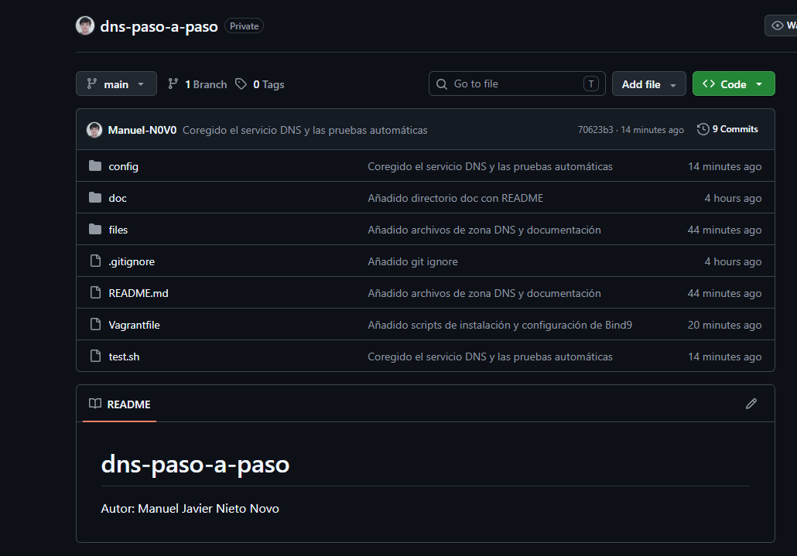
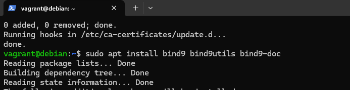
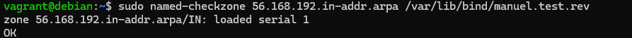
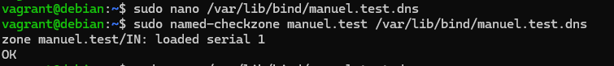
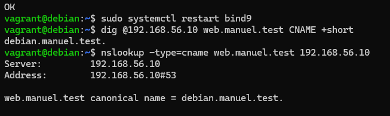
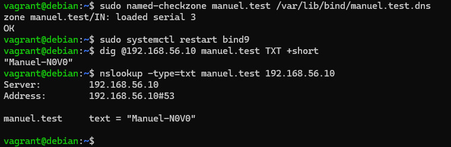
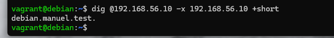
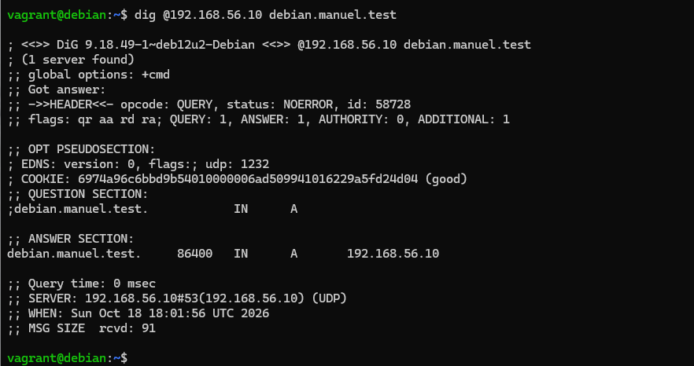
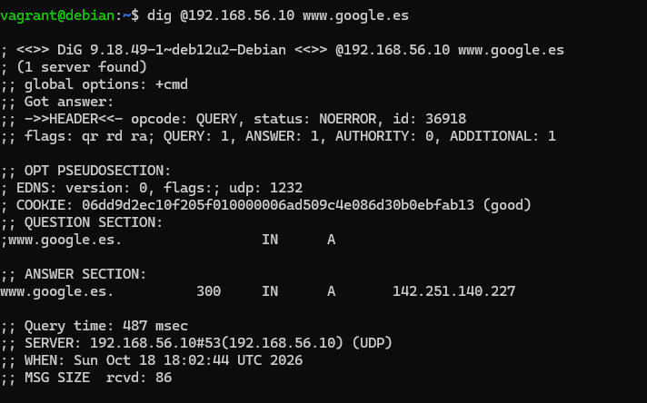
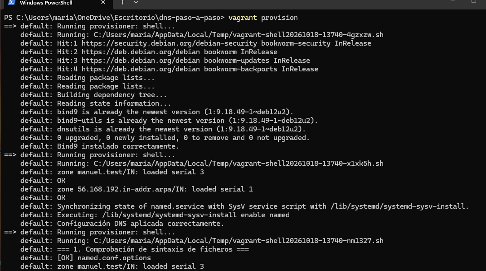

# Configuración de un servidor DNS

## 1. Objetivo

En esta práctica he instalado y configurado un servidor DNS con Bind9 en una máquina virtual Debian utilizando Vagrant. El dominio creado es `manuel.test` y la IP del servidor es `192.168.56.10`.

## 2. Repositorio en GitHub

He creado un repositorio privado llamado `dns-paso-a-paso` para guardar los archivos y los cambios realizados durante la práctica.



## 3. Creación de la máquina virtual

He configurado el archivo `Vagrantfile` para crear una máquina Debian con la IP privada `192.168.56.10`. El proyecto está organizado en las carpetas `config/` y `files/`.

## 4. Instalación de Bind9

He instalado Bind9 y las herramientas necesarias para comprobar el funcionamiento del servidor DNS mediante el siguiente comando:

```bash
sudo apt update
sudo apt install bind9 bind9-utils dnsutils
```



También he creado el script `config/01-instalar-bind.sh` para automatizar la instalación.

## 5. Configuración del servidor

He configurado los archivos `named.conf`, `named.conf.options` y `named.conf.local`. He establecido las opciones de escucha, la recursividad y el acceso permitido a la red local.

## 6. Zonas DNS

He creado la zona directa `manuel.test` y la zona inversa `56.168.192.in-addr.arpa`. Los archivos de zona se copian desde `files/` al directorio `/var/lib/bind/`.





## 7. Comprobación de la configuración

He utilizado `named-checkconf` y `named-checkzone` para comprobar que la configuración y los archivos de las zonas no tengan errores. Después, he reiniciado el servicio y comprobado su estado.

## 8. Pruebas de resolución DNS

He utilizado `dig` y `nslookup` para comprobar los registros DNS configurados.

**Registro CNAME:**



**Registro TXT:**



**Registro PTR:**



## 9. Comprobación de autoridad

He consultado mi dominio y un dominio externo para comparar la bandera `aa`.

En mi dominio aparece `aa` porque el servidor responde de forma autoritativa para esa zona. En la consulta externa no aparece porque mi servidor no es el servidor autoritativo de ese dominio.





## 10. Pruebas automáticas

He creado el script `test.sh` para comprobar la configuración, las zonas y varios registros DNS. Este script también se ejecuta durante el aprovisionamiento de Vagrant.



## 11. Git y entrega

He guardado los cambios mediante commits y los he subido al repositorio de GitHub. Para entregar la práctica, proporcionaré la URL del repositorio y descargaré el proyecto en ZIP desde GitHub para subirlo a Moodle.
